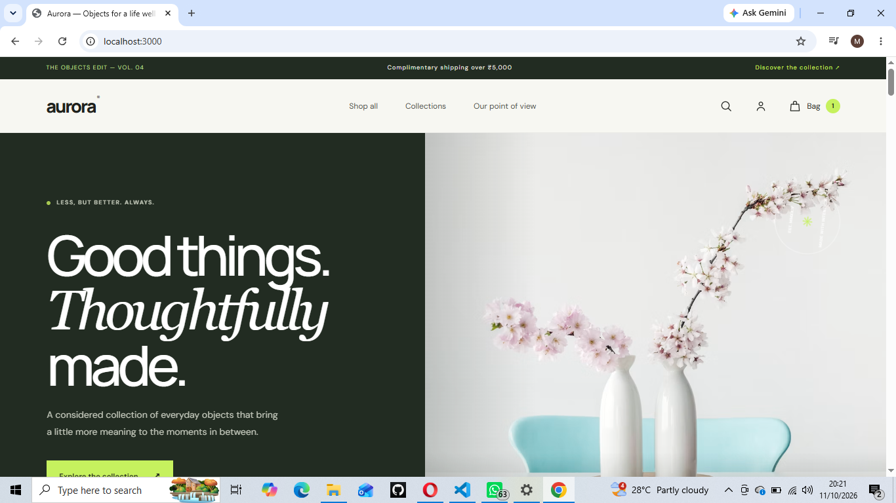
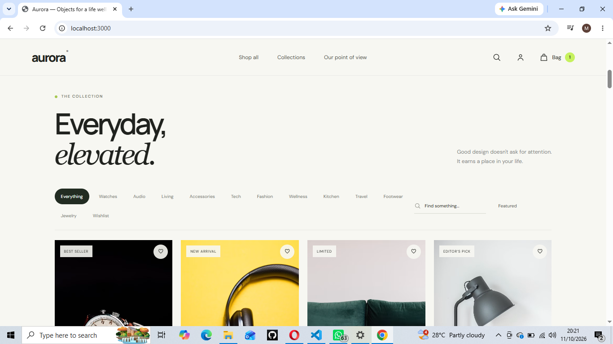
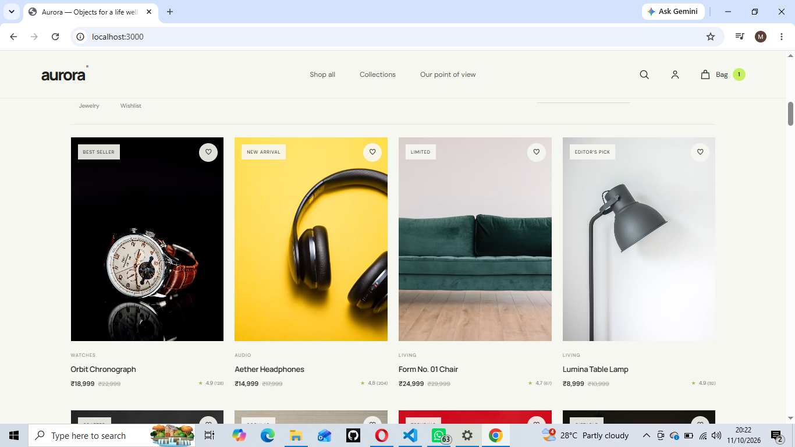
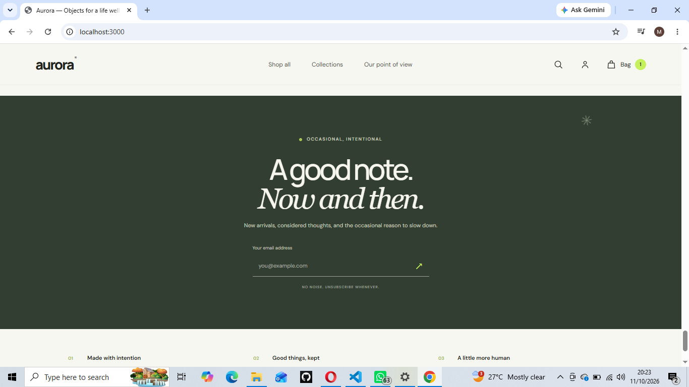
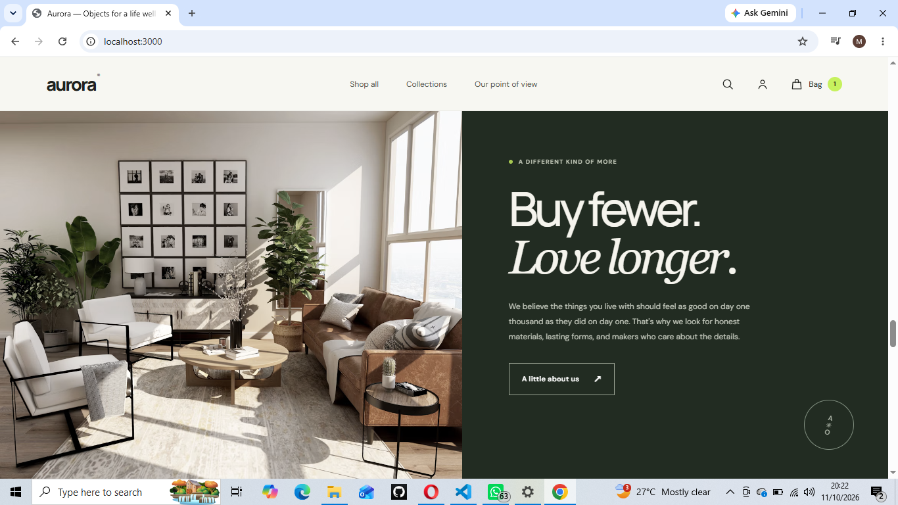

<div align="center">

# ✳️ A U R O R A
### **𝑶𝒃𝒋𝒆𝒄𝒕𝒔 𝒇𝒐𝒓 𝒂 𝒍𝒊𝒇𝒆 𝒘𝒆𝒍𝒍 𝒄𝒐𝒏𝒔𝒊𝒅𝒆𝒓𝒆𝒅.**

*Thoughtful things. Beautifully found. Made for living.*

<br>


**38 considered finds · 11 shoppable collections · One very good bag** 🛍️

</div>

---

## ✨ The feeling

Aurora is a full-stack storefront with a quiet-luxury look, a custom animated sign-in experience, and real server-backed shopping flows. Browse a growing collection of sneakers, jewelry, home objects, audio, travel essentials, and more.

> **Good things. Thoughtfully made.**  
> Explore the collection, keep a wishlist, and send your favourites home.

## 🪄 What’s inside

| ✦ | Experience |
|---|---|
| 🛒 | **Shop beautifully** — product search, collection filters, sorting, details, stock-aware cart, and persistent wishlist. |
| 👟 | **Find your fit** — branded-style sneaker listings, everyday footwear, and dedicated shoes and jewelry collections. |
| 💍 | **Little details** — rings, bracelets, cuffs, hoops, studs, and necklaces. |
| 🔐 | **Your own corner** — sign up, sign in, hashed passwords, expiring server-side sessions, and sign out. |
| 📦 | **From bag to doorstep** — saved addresses, cash-on-delivery, order history, and fulfillment tracking. |
| 💳 | **Razorpay checkout** — server-created orders and server-side payment signature verification. UPI and PhonePe availability depends on your merchant account. |
| 👑 | **The studio** — administrator-only product creation, price and stock edits, order management, and store statistics. |
| 📱 | **Made to move** — responsive layouts, mobile navigation, accessible controls, and reduced-motion support. |

## 📸 A little look around

Here’s a glimpse of the Aurora storefront, captured from the running app:

<table>
  <tr>
    <td align="center" width="50%">
      <a href="SCREENSHOTS/HERO.png"></a><br>
      <strong>✳ The first impression</strong><br>
      <sub>A bold editorial hero, calm typography, and an invitation to explore.</sub>
    </td>
    <td align="center" width="50%">
      <a href="SCREENSHOTS/HOME.png"></a><br>
      <strong>🛍️ The product edit</strong><br>
      <sub>Product cards bring prices, ratings, wishlists, and quick-add actions together.</sub>
    </td>
  </tr>
  <tr>
    <td align="center" width="50%">
      <a href="SCREENSHOTS/COLLECTIONS%202.png"></a><br>
      <strong>🧭 Find your collection</strong><br>
      <sub>Browse the catalog using the collection filters and product search.</sub>
    </td>
    <td align="center" width="50%">
      <a href="SCREENSHOTS/COLLECTIONS.png"></a><br>
      <strong>💍 Details worth keeping</strong><br>
      <sub>A closer look at the shoppable catalog, from everyday finds to accessories.</sub>
    </td>
  </tr>
  <tr>
    <td align="center" width="50%">
      <a href="SCREENSHOTS/FOOTER.png"></a><br>
      <strong>👟 A fresh step, a finishing touch</strong><br>
      <sub>See footwear and jewelry styles in the expanded Aurora range.</sub>
    </td>
    <td align="center" width="50%">
      <a href="SCREENSHOTS/TRUSTED.png"></a><br>
      <strong>🌿 The Aurora point of view</strong><br>
      <sub>Thoughtful materials, lasting forms, and a slower approach to everyday design.</sub>
    </td>
  </tr>
  <tr>
    <td align="center" width="50%">
      <a href="SCREENSHOTS/COLLECTIONS%203.png"></a><br>
      <strong>✉️ An occasional, intentional note</strong><br>
      <sub>A quiet newsletter signup, styled to match the storefront.</sub>
    </td>
    <td width="50%"></td>
  </tr>
</table>

> 🔒 **Privacy note:** Checkout, payment, and order-history screenshots are kept out of this public gallery because they may show personal contact or transaction details. Redact those details before sharing such screenshots publicly.

## 🚀 Start your store

### 1. Get set up

Install **Node.js 20+**, then open PowerShell in this project folder:

```powershell
cd "C:\Users\NIC KRMN\Desktop\ecommerce"
npm install
```

### 2. Configure your local environment

Create `.env` from the example **only if you don’t already have your local `.env`**:

```powershell
Copy-Item .env.example .env
```

Keep an existing `.env`—it may already contain your private payment keys. Configure these values in `.env`:

```env
PORT=3000
SESSION_SECRET=your-long-random-session-secret
ADMIN_EMAIL=you@example.com
ADMIN_SETUP_TOKEN=your-private-one-time-owner-setup-key
```

To enable online checkout, add your **Razorpay Test Mode** keys:

```env
RAZORPAY_KEY_ID=rzp_test_your_key_id
RAZORPAY_KEY_SECRET=your_private_test_secret
```

🔒 **Keep secrets secret.** `.env` is git-ignored. Never paste the Razorpay secret into frontend code, commit it, or share it.

### 3. Launch ✨

```powershell
npm run dev
```

Open **[http://localhost:3000](http://localhost:3000)**. The development command builds the Tailwind CSS and Flowbite browser assets, then starts the Express server.

> **Already running?** Don’t start a second dev server on the same port. Stop the existing one with **Ctrl+C** first, or choose a different `PORT` in `.env`.

## 👑 Create the store owner account

Register with the email in `ADMIN_EMAIL` and enter the matching `ADMIN_SETUP_TOKEN` in the signup form’s **Store setup key · owners only** field. Other accounts are customers. Once the owner account is created, remove `ADMIN_SETUP_TOKEN` from `.env`; keep `ADMIN_EMAIL` configured so the admin role remains restricted to that account.

## 💳 Try a test checkout

1. Add a product to your bag.
2. Sign in and enter a delivery address.
3. Choose **Pay online with Razorpay**.
4. Use a payment method from [Razorpay’s test instructions](https://razorpay.com/docs/payments/payments/test-card-upi-details/).

The browser only receives the public Razorpay Key ID. The server creates the payment order and verifies the signature before confirming an order or changing inventory. Use **test keys** until your account and deployment are ready for live transactions.

## 🧰 Handy commands

```powershell
npm run dev       # Build storefront assets and start the development server
npm run build     # Build Tailwind CSS and copy Flowbite assets
npm start         # Start the Express server
npm audit         # Check package dependency advisories
```

## 🪵 Under the hood

- **UI:** HTML, handcrafted CSS, Tailwind CSS, Flowbite, and vanilla JavaScript.
- **Server:** Node.js and Express.
- **Payments:** Razorpay Checkout with server-side order creation and signature verification.
- **Local persistence:** JSON file storage in `data/store.json`, created automatically.

The current JSON store is intended for **local development and a single server process**; it is not a transaction-safe production database. Before a public launch, migrate accounts, inventory, orders, payments, sessions, and subscribers to PostgreSQL or another transactional database. Configure HTTPS, production rate limiting, payment webhooks, logging, and backups.

## 🌱 Not configured yet

Email OTP, email-based password recovery, Google sign-in, newsletter email delivery, promotions, and catalog deletion need real provider credentials and additional workflows. Newsletter signups are stored locally but no emails are sent. Customer email addresses are not verified—add a verified email flow before enabling public production registration.

---

<div align="center">

### **Less, but better. Always.** ✳️

*Made for the everyday · Designed to last · Kept close*

</div>
